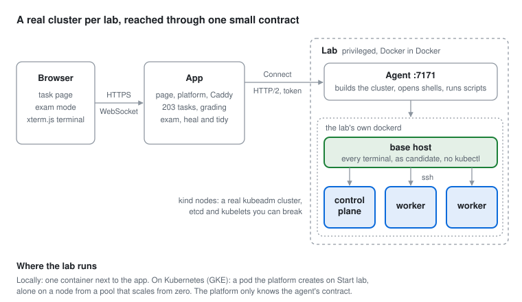

# cka-sim

A practice simulator for the CKA exam. Pick a task, get a real Kubernetes cluster, and solve it in a terminal
in your browser the way the exam does: start on a host with no cluster access, then `ssh` to a node.

Not a mock. Every lab is a real kubeadm cluster with etcd, static pods and kubelets, so you can break a control
plane and fix it the way the exam asks you to. 203 tasks across every CKA domain, each graded by scripts on the
cluster, plus a timed exam mode.



## Run it

You need Docker, with at least 2 CPUs and 4 GiB of memory for it. No clone needed:

```sh
curl -fsSL https://raw.githubusercontent.com/MohamedAljoke/cka-sim/main/infra/local/install.sh | sh
```

That installs the `cka-sim` command and starts it. Open http://localhost:7080, pick a task and click
**Start lab**. The first cluster takes a few minutes while the images download; later ones reuse them.

```sh
cka-sim down | up | status | update | uninstall
cka-sim logs lab     # follow one part's logs: lab or app
cka-sim shell        # the page's terminal, in yours
```

To host it on Kubernetes instead, see [docs/HOSTING.md](docs/HOSTING.md).

## What's inside

- **A whole cluster in one container.** The lab is a privileged container with its own Docker, and
  [kind](https://kind.sigs.k8s.io), used as a Go library rather than a CLI, makes each node a container inside
  it. The agent turns kind's logger calls into live build steps on the page. → [docs/LAB.md](docs/LAB.md)
- **An exam-like base host.** Every terminal lands as `candidate` on a host with no kubectl. Each node has
  sshd, candidate's key, a kubeconfig and `sudo`, built into a custom node image. → [docs/LAB.md](docs/LAB.md)
- **A browser terminal that is a real shell.** Keystrokes go from xterm.js over a WebSocket to a bidirectional
  Connect stream over HTTP/2, then to a pty on the agent, and from there to `docker exec` into bash. Resizes
  pass through `ssh` too, so `vim` and `top` draw correctly. → [docs/TERMINAL.md](docs/TERMINAL.md)
- **Tasks graded on the cluster.** Each task is a folder of scripts:
  - `setup.sh` breaks or prepares the cluster;
  - `check.sh` grades it;
  - `solution.sh` solves it;
  - `reset.sh` heals whatever the task broke.

  A selftest solves every task on a real cluster to prove its checks. The exam draws tasks by domain weight
  and runs on the clock. → [docs/TASKS.md](docs/TASKS.md)
- **A lab per student on Kubernetes.** Hosted, each student joins with an invite link, and the platform uses
  client-go to create their own privileged lab pod when they click Start lab, on its own node from a pool that
  scales from zero up to a cap, and deletes it when they stop. It is scoped by RBAC and fenced by a
  NetworkPolicy, and Terraform and kustomize set it up. The platform only knows the agent's contract, so the
  same lab runs as a container or a pod. → [docs/HOSTING.md](docs/HOSTING.md)

## The code

| Path | What it is |
| --- | --- |
| `apps/platform` | Go API: the task catalog, grading, the exam, and the terminal proxy |
| `apps/lab` | Go agent inside the lab: cluster lifecycle, shells and task scripts |
| `apps/assistant` | Go MCP server: the tutor's tools for an AI CLI, over the platform's `TutorService` |
| `apps/web` | TypeScript + Vite page with xterm.js |
| `apps/go-shared` | Protobuf contracts and shared helpers, the only code apps may share |
| `infra/app`, `infra/lab` | The two images, the same wherever they run |
| `infra/local` | Docker Compose and the `cka-sim` command with its installer |
| `infra/gke` | Terraform for the cluster and kustomize manifests for the app |
| `docs/` | How it works; `docs/dev/` holds the build plan and status |

Apps never import each other, each follows a domain / use cases / adapters layout, and every endpoint has
end-to-end tests against the real binary. The rules are in [AGENTS.md](AGENTS.md). From a clone,
`cp .env.example .env`, then `make` lists the development commands.

**Stack:** Go, Connect + Protobuf, kind, Docker in Docker, client-go, Terraform, GKE, TypeScript, Vite, xterm.js.
