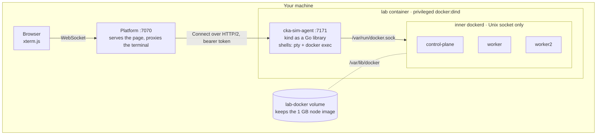
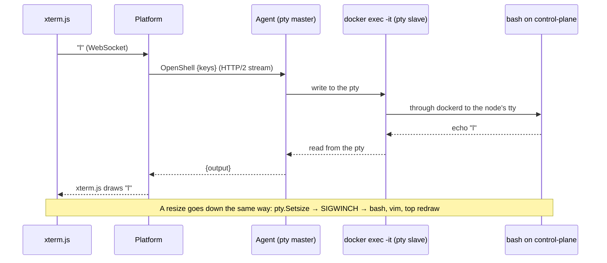

# cka-sim

A practice simulator for the CKA exam: pick a task, get a real Kubernetes cluster, solve it in a root shell in
your browser.

Not a mock. Every cluster is a real kubeadm cluster with a real etcd, static pods and kubelets, so you can
break a control plane and fix it the way the exam asks you to.

## How it works

- **A whole cluster in one container.** The lab container runs its own Docker, and [kind](https://kind.sigs.k8s.io)
  turns each node into a container inside it. Three levels deep: your Docker → the lab's Docker → the cluster's
  containerd.
- **kind as a Go library, not a CLI.** The agent drives cluster creation in-process and turns kind's logger
  calls into live progress, with no log scraping. Config is embedded in the binary, and a cgroup v1 patch is
  added only when the host needs it.
- **A browser terminal that is a real shell.** Keystrokes travel WebSocket → platform → a bidirectional Connect
  stream → a pty on the agent → `docker exec -it` → bash on the control-plane node. What you see is bash's
  echo coming back; resizes are copied down to the node's terminal so `vim` and `top` draw correctly.
- **The platform never touches Docker.** It only knows the agent's contract
  ([`lab.proto`](apps/go-shared/contract/lab/v1/lab.proto)), so a lab could later run on a VM or GKE without the
  platform changing.
- **Clean ends.** Killing `docker exec` leaves bash running in the node, so each shell is tagged in its
  environment and the agent hunts down every tagged process on close.

One keystroke, there and back:

The full walkthrough, from Docker-in-Docker quirks to how HTTP/2 streams both ways, is in
[docs/LAB-INTERNALS.md](docs/LAB-INTERNALS.md).

## The code

| Path | What it is |
| --- | --- |
| `apps/platform` | Go API: task catalog (`task.md`, `setup.sh`, `check.sh` per task) and the terminal proxy |
| `apps/lab` | Go agent that runs inside the lab container: cluster lifecycle and shells |
| `apps/web` | TypeScript + Vite page with xterm.js |
| `apps/go-shared` | Protobuf contracts and shared helpers, the only code apps may share |
| `infra/local` | Compose file for the lab container |

Apps never import each other, each follows a domain / use cases / adapters layout, and every endpoint has
end-to-end tests against the real binary. The rules are in [AGENTS.md](AGENTS.md).

**Stack:** Go, Connect + Protobuf, kind, Docker-in-Docker, creack/pty, TypeScript, Vite, xterm.js.

## Status

Being rebuilt step by step on this branch; [docs/REBUILD-STATUS.md](docs/REBUILD-STATUS.md) tracks what has
landed and [docs/REBUILD-IN-STEPS.md](docs/REBUILD-IN-STEPS.md) what comes next. Next up: grading, then a
killer.sh-style exam mode.

Setup and usage instructions are coming. For now, `cp .env.example .env` and `make` lists the commands.
