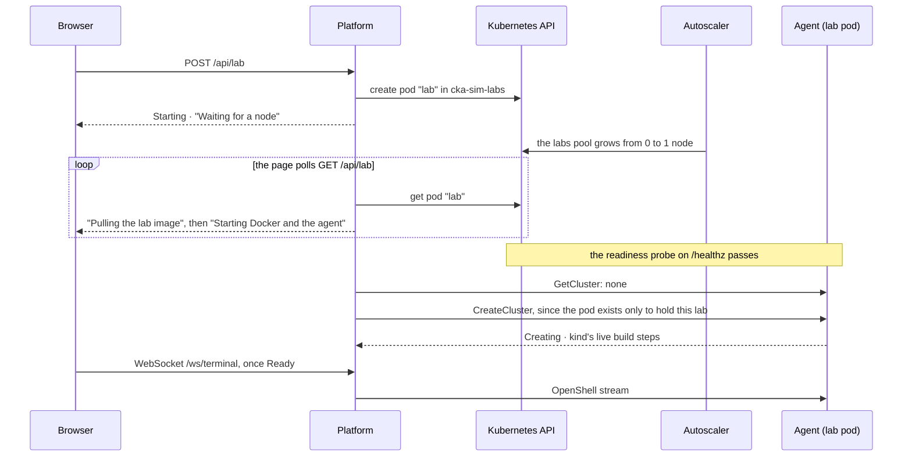

# Hosting: labs on demand on Kubernetes

Locally, the lab is one container that is always there. Hosted, the platform creates the lab as a pod when you
click **Start lab**, on a node of its own that the cluster adds for it, and deletes it when you stop. The lab
image, the agent and the platform's use cases are the same in both places. Only the code that brings the machine
up differs.

> [!NOTE]
> Written and checked offline: `terraform validate`, `kustomize build` and `caddy adapt` all pass. It has not yet
> been run on a live cluster. It hosts one lab, for one person, with no accounts: an IP allowlist keeps
> everyone else out.

**Contents:** [1. A lab is a lab anywhere](#1-a-lab-is-a-lab-anywhere) · [2. Start lab, step by step](#2-start-lab-step-by-step) ·
[3. The lab pod](#3-the-lab-pod) · [4. Who can reach the lab](#4-who-can-reach-the-lab) ·
[5. The cluster: Terraform](#5-the-cluster-terraform) · [6. The app: kustomize and Caddy](#6-the-app-kustomize-and-caddy) ·
[7. Run it](#7-run-it)

## 1. A lab is a lab anywhere

The platform's lab use cases need two things: a `LabProvider` (Get, Start, Stop) and a `ScriptRunner`.
`labagent.Lab` (`apps/platform/internal/infra/adapters/labagent/lab.go`) provides both, and it is the only code
that talks to an agent. What it doesn't know is where the agent runs. It asks a `Machine` for that:

```go
type Machine interface {
	Up(ctx context.Context) error                       // make sure the machine exists
	Down(ctx context.Context) (removed bool, err error) // remove it, cluster and all
	Where(ctx context.Context) (Place, error)           // the agent's URL, or why there is none yet
}
```

| Machine | Up | Down | Where |
| --- | --- | --- | --- |
| `labagent.Fixed` (local) | nothing: the container is always there | nothing, so Stop asks the agent to delete its cluster | the one URL from `CKA_SIM_LAB_URL` |
| `kube.Pod` (hosted) | creates the pod | deletes the pod, taking the cluster with it | the pod's IP once it's Ready; until then a Starting lab with a step, or Failed |

`CKA_SIM_LABS=local|kubernetes` picks one in `cmd/server/main.go`. Nothing in `kube` is tied to GKE, so EKS or
any other cluster would be a new Terraform folder, not new Go code.

## 2. Start lab, step by step



The page's state comes from two places:
- **While the pod is not ready**, from the pod itself: `kube.stateOf` reads its conditions and phase.
- **Once it is Ready**, from the agent, as it does locally.

| The pod | The lab |
| --- | --- |
| not found | None |
| not scheduled | Starting: "Waiting for a node" |
| scheduled, Pending | Starting: "Pulling the lab image" |
| running, not Ready | Starting: "Starting Docker and the agent" |
| Ready | whatever the agent says; an agent with no cluster is told to build one |
| `ErrImagePull`, `ImagePullBackOff`, `CreateContainer*Error` | Failed, with the reason: these don't fix themselves |
| Failed or Succeeded | Failed: "the lab pod stopped" |
| being deleted | Stopping, and Start refuses until it has gone |

**Stop lab** deletes the pod. The kind cluster lived in the pod's emptyDir, so it goes too, and the cluster
autoscaler removes the empty node about 10 minutes later.

## 3. The lab pod

`kube.PodSettings.spec()` (`apps/platform/internal/infra/adapters/kube/pod.go`) is the Compose file's lab
container, written as a pod:

| Field | Why |
| --- | --- |
| `privileged: true` | dockerd and kind's nodes make cgroups, mounts and networks |
| `emptyDir` at `/var/lib/docker` | The inner Docker's storage; it can't be the node's overlayfs |
| `hostPath /lib/modules`, read-only | kube-proxy and the CNI inside kind load kernel modules |
| `nodeSelector pool=labs` and a toleration for `lab=true:NoSchedule` | Only the lab lands on the labs pool, and it lands nowhere else |
| requests of 2 CPU and 8 Gi | Takes a whole `e2-standard-4`, so each lab is alone on its node |
| `restartPolicy: Never` | A crashed lab shows as Failed, and Start makes a fresh one |
| token from Secret `cka-sim-agent` | The agent accepts only the app's bearer token, and it never sits in a manifest |
| no ServiceAccount token, no service links | Nothing in the lab can talk to the hosting cluster's API |
| readiness probe on `/healthz` | "Ready" means the agent answers |

The labs pool runs `UBUNTU_CONTAINERD` nodes, because kind needs a regular Linux's kernel modules and cgroups,
which Container-Optimized OS doesn't give it.

## 4. Who can reach the lab

Inside the lab, root on a node can break out to the privileged pod, and from there to its node. So the node is
the boundary, and the rules are about who can reach it and what it can reach:

- **The app's RBAC** (`infra/gke/k8s/lab.yaml`): ServiceAccount `cka-sim-app` gets a Role with get, create and
  delete on pods, in `cka-sim-labs` only. It can't touch anything else in the cluster.
- **NetworkPolicy `lab`**, enforced by Dataplane v2:
  - Only pods labelled `app: cka-sim-app` in `cka-sim` reach port 7171.
  - The lab can reach DNS and the internet, for the images its cluster pulls, but no private range and not
    `169.254.0.0/16`, so not the metadata server either.
- **The node itself:** the labs pool is tainted and the pod takes a whole node, so no other workload shares it.

## 5. The cluster: Terraform

`infra/gke/terraform/` makes what lives in GCP:

| Resource | What |
| --- | --- |
| `google_container_cluster.cka_sim` | Zonal, `southamerica-east1-a`, Dataplane v2 (`ADVANCED_DATAPATH`), the default pool removed |
| `google_container_node_pool.system` | `e2-medium`, 1–2 nodes: the app and GKE's own pods |
| `google_container_node_pool.labs` | `e2-standard-4` on Ubuntu, **0–1 nodes**, label `pool=labs`, taint `lab=true:NoSchedule` |
| `google_compute_address.site` | The static IP the site answers on |

A labs pool that scales from zero means an idle site pays for no lab node. The price is a cold start: a new
node, the image pull, then the kind build, a few minutes in all.

## 6. The app: kustomize and Caddy

`infra/gke/k8s/` is applied with `kubectl apply -k`:

- **`app.yaml`:**
  - the `app` Deployment, the same `cka-sim-app` image as `cka-sim up`, with `CKA_SIM_LABS=kubernetes`;
  - a PVC for the saved exam and Caddy's certificates;
  - a LoadBalancer Service on the static IP.
- **`lab.yaml`:** the RBAC and the NetworkPolicy above.
- **`kustomization.yaml`:** builds two ConfigMaps:
  - `site`, from `site.env`, which `make site` writes from Terraform's output and your address;
  - `caddy`, from the `Caddyfile`.

  Their names carry a hash of their content, so a change restarts the app. A replacement copies `SITE_IP` into
  the Service's `loadBalancerIP`.

**The allowlist lives in Caddy, not on the load balancer.** Caddy serves `https://<ip>.sslip.io` with a Let's
Encrypt certificate. Its `route` drops any client outside `CKA_SIM_ALLOW` before anything is served. Let's
Encrypt still gets through, because Caddy answers its challenges before any route runs. For Caddy to see your
real address, the Service has `externalTrafficPolicy: Local`, so the load balancer doesn't hide the source
address behind a node's.

## 7. Run it

Every command runs against GCP project `cka-sim-gke-maljoke` and the context Terraform prints, never the current
kubectl context.

```sh
make -C infra/gke up          # the cluster, then the site; about 10 minutes, then prints the URL
make -C infra/gke allow       # your IP changed: let the new one in
make -C infra/gke lab-down    # delete the lab pod, as Stop lab does
make -C infra/gke site-down   # remove the app, the lab and the load balancer; the cluster stays
make -C infra/gke down        # delete the cluster and the IP too
```

**Cost**, roughly: with no lab running, about US$1.5–2 a day, for the system node, the load balancer and the
disks. A running lab node adds about US$0.20 an hour, until about 10 minutes after Stop lab.
