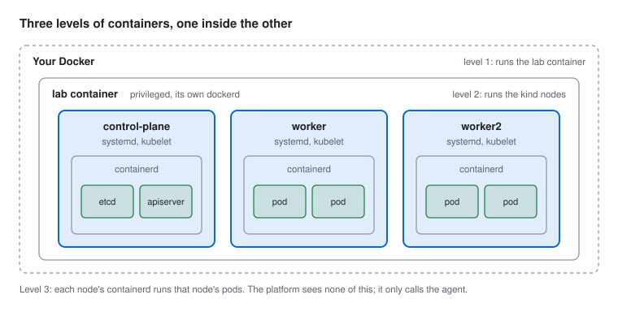
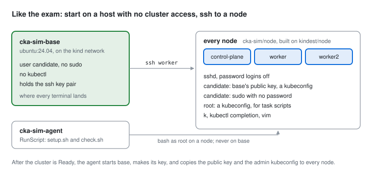
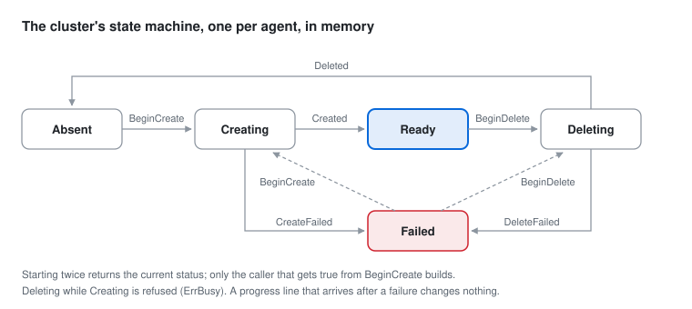

# The lab: a Kubernetes cluster in one container

A lab is one container that holds the agent and its own Docker. The agent builds a real kubeadm cluster there with
kind, plus an exam-like base host where every terminal lands. How a keystroke reaches that host is in
[TERMINAL.md](TERMINAL.md), and how the lab runs as a pod on Kubernetes is in [HOSTING.md](HOSTING.md).

**Contents:** [Big picture](#the-big-picture) · [1. Docker in Docker](#1-docker-in-docker) ·
[2. kind](#2-kind-a-cluster-made-of-containers) · [3. The base host and ssh](#3-the-base-host-and-ssh) ·
[4. Cluster state](#4-the-clusters-state-lives-in-one-process) · [5. Who can reach what](#5-who-can-reach-what) ·
[6. Try it](#6-try-it-yourself)

## The big picture


| Part | Where | What it does |
| --- | --- | --- |
| Browser | xterm.js | Draws the terminal and talks to the platform over the WebSocket `/ws/terminal` |
| Platform | `:7070` | Serves the API and translates the WebSocket into `LabService` calls, with a bearer token |
| Agent | `:7171`, in the lab container | Builds the cluster and the base host, opens shells on base, runs task scripts on nodes |
| Inner dockerd | in the lab container | Runs the kind nodes and the base host. It listens on a Unix socket only |
| Base host | `cka-sim-base` | Where every terminal lands, as `candidate`, with no kubectl. `ssh <node>` from there |
| `lab-docker` volume | `/var/lib/docker` | Keeps the pulled and built images between runs |



> [!NOTE]
> The platform never talks to Docker. It only talks to the agent, so the same lab image runs as a container next
> to the app or as a pod on Kubernetes ([HOSTING.md](HOSTING.md)), and the platform's use cases don't change.

## 1. Docker in Docker

The lab image is `docker:28-dind` plus the agent (`infra/lab/lab.Dockerfile`). `lab-start.sh` starts dockerd,
waits until `docker info` answers, and then execs the agent.

| Problem | Fix |
| --- | --- |
| dockerd and kind's nodes create cgroups, mount filesystems and change networking, which a normal container can't do | `privileged: true` |
| `kindest/node` is about 1 GB | The `lab-docker` volume keeps `/var/lib/docker`, so only the first cluster downloads it |
| Three kubelets run out of the kernel's default inotify watches | `lab-start.sh` raises `fs.inotify.max_user_watches` and `max_user_instances` |
| A restarted container keeps `/var/run`, and dockerd then waits forever for a containerd that is gone | `lab-start.sh` deletes the stale pid files first |
| Docker must not be reachable from outside | dockerd listens on a Unix socket only; only the agent uses it |

```sh
docker exec cka-sim-lab-1 docker ps    # base and the nodes, one level down
```

## 2. kind: a cluster made of containers

kind ("Kubernetes in Docker") makes each node a container from a node image, which has systemd, containerd and a
kubelet. It runs `kubeadm init` on the control plane and `kubeadm join` on the workers. The result is a real
cluster, with a real etcd, static pods and kubelets you can break and fix, which is exactly what CKA tasks need.

**kind is a Go library here, not the `kind` CLI** (`apps/lab/internal/infra/adapters/kind/kind.go`):

```go
kindcluster.NewProvider(ProviderWithDocker(), ProviderWithLogger(stepLogger{progress}))
```

- `Create` gets our node image, the cluster config, a kubeconfig path (`~/.cache/cka-sim/<name>.kubeconfig`, so
  `~/.kube/config` stays untouched) and `WaitForReady(5m)`.
- kind still drives Docker through the `docker` CLI, so it follows the current Docker context, inside the lab
  container or on your machine alike.
- `kind.yaml` (1 control plane, 2 workers), the cgroup v1 patch and both Dockerfiles are embedded with
  `//go:embed`, so the binary carries everything it builds.

**An exam-like node image.** Before kind starts, the agent builds `cka-sim/node:v1.37.0` from `node.Dockerfile`
with `docker build -`, inside the lab's own Docker. On top of `kindest/node` it adds:

- sshd, enabled through systemd (kind's entrypoint has to stay PID 1, so sshd can't be the `CMD`), with password
  logins off
- a `candidate` user with sudo and no password
- vim, bash completion, `alias k=kubectl` and kubectl completion for `k`

A unit test checks that the tag matches the `FROM` line, so the two can't drift apart.

**cgroups.** Kubernetes 1.35+ kubelets refuse cgroup v1 unless the config sets `failCgroupV1: false`. The agent
asks `docker info` which version the host uses and adds the patch only for v1. WSL2 and modern Linux use v2.

**Live progress, with no log file.** kind reports its phases by calling the logger it was given:

```
kind logs " ✓ Preparing nodes 📦"  →  stepLogger strips it to "Preparing nodes"  →  progress(step)  →  Status.Step
```

`progress` is `cluster.Progress`, which overwrites one string under a mutex. The agent adds its own steps the
same way: "Building the node image", "Waiting for every node to be Ready", "Starting the base host". No
`docker logs` and no polling: just function calls inside the agent process.

**kind only waits for the control plane.** After `Create` returns, `waitForNodes` runs `kubectl` in the
control-plane container until every node is Ready.

**Every start is fresh.** At startup the agent deletes any cluster with its name. This process didn't watch a
cluster from before a restart, so its state is unknown.

## 3. The base host and ssh

The CKA exam starts you on a machine with no cluster access, and each task says which node to `ssh` to first.
cka-sim copies that with a fourth container next to the nodes (`apps/lab/internal/infra/adapters/kind/base.go`).



After every node is Ready, `startBase`:

1. builds `cka-sim/base` from `base.Dockerfile`: Ubuntu with an ssh client, vim and curl, a `candidate` user
   with no sudo, and **no kubectl**
2. runs it as `<cluster>-base` with `--network kind`, so node names like `cka-sim-worker` resolve, and `--init`,
   so the processes ended shells leave behind are reaped
3. makes an ed25519 key pair for `candidate` on base
4. copies to every node, with `docker exec -i … install`:

| File on each node | Owner | Why |
| --- | --- | --- |
| `/home/candidate/.ssh/authorized_keys` | candidate | base's public key, so `ssh <node>` needs no password |
| `/home/candidate/.kube/config` | candidate | kubectl works right after `ssh`, on any node |
| `/root/.kube/config` | root | `setup.sh` and `check.sh` run as root on the task's node, and only the control plane came with one |

Base's ssh config sets `User candidate` and turns off host key checking. Every new cluster recreates the
nodes with new host keys, and a "host key changed" warning would only get in the way.

**Where things run:**

| What | Where | As |
| --- | --- | --- |
| The page's terminal and `cka-sim shell` | base | candidate |
| `ssh <node>` from there | that node | candidate, `sudo` for root |
| `RunScript` (setup and check) | the task's node, never base | root |

`RunScript` only accepts a host from `Nodes`, so asking for base, or any other container, is INVALID_ARGUMENT
(`ErrUnknownHost`). `Delete` removes base first, then the cluster.

## 4. The cluster's state lives in one process



`apps/lab/internal/domain/cluster/cluster.go` is a small state machine guarded by a mutex. Ready means the
nodes and base are both up: `Create` returns only after `startBase`.

| Rule | Why |
| --- | --- |
| Repeats are safe: starting twice returns the current status | Only the caller that gets `true` from `BeginCreate` launches the build |
| Conflicts are refused: deleting while Creating returns `ErrBusy` | The API answers FAILED_PRECONDITION |
| Late callbacks are ignored | A progress line after a failure changes nothing |
| It lives in memory | Fine for one lab per agent |

The build runs in a goroutine with `context.WithoutCancel` and a 20-minute limit, so it outlives the HTTP call
that started it.

## 5. Who can reach what

| From | Can reach | Can't reach |
| --- | --- | --- |
| The terminal, on base | every node over ssh, as candidate; the agent's port over the network | the cluster directly (no kubectl, no kubeconfig); any RPC, because it has no token ([TERMINAL.md](TERMINAL.md#1-platform--agent-connect-over-http2)) |
| candidate on a node | root, with `sudo` and no password | |
| Root on a privileged node | the lab container, by breaking out, and the lab container is privileged too | |
| Any website you visit | nothing, because the WebSocket checks the `Origin` | |

> [!IMPORTANT]
> **The shell user is not the boundary.** CKA tasks need root on the nodes, so `sudo` is one command away, and
> from there a privileged node can reach the lab container. **One lab container per learner is the boundary**,
> plus whatever isolates that container. Hosted, that is a pod alone on its own node, which only the app can
> reach ([HOSTING.md](HOSTING.md#4-who-can-reach-the-lab)).

The origin check matters because a GET is a "safe" method, so `CrossOriginProtection` lets the WebSocket upgrade
through. Without the check, any site could open a shell through your platform.

## 6. Try it yourself

**The lab in its container** (agent on 7171):

```sh
make lab
docker exec cka-sim-lab-1 docker ps                                            # base and the nodes
docker exec cka-sim-lab-1 docker exec cka-sim-control-plane kubectl get nodes  # the cluster
```

**The agent straight on your machine's Docker**, beside the container:

```sh
cd apps/lab && go build -o /tmp/agent ./cmd/agent
CKA_SIM_AGENT_ADDR=127.0.0.1:7272 CKA_SIM_CLUSTER=cka-sim-local \
  CKA_SIM_AGENT_TOKEN=local-only-agent-token-not-a-secret /tmp/agent

T=local-only-agent-token-not-a-secret
curl -s -H "Authorization: Bearer $T" -H 'Content-Type: application/json' -d '{}' \
  http://127.0.0.1:7272/lab.v1.LabService/CreateCluster
docker ps    # cka-sim-local-base, cka-sim-local-control-plane and its workers
```

**A real cluster through the agent** (takes a few minutes). The test opens a shell, checks it is `candidate` with
no kubectl, then runs `kubectl get nodes` over `ssh` on a worker:

```sh
cd apps/lab && go test ./e2e -create
```
