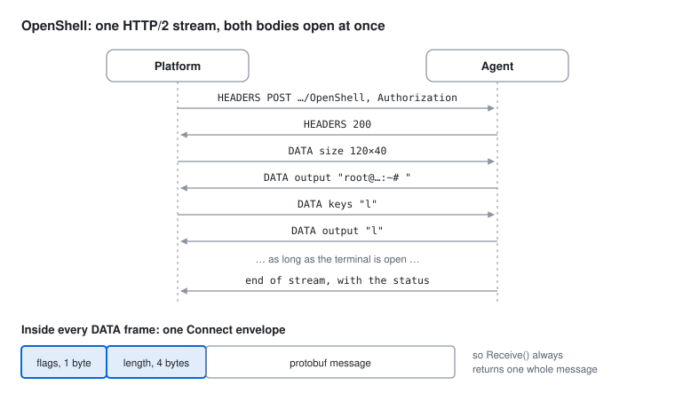
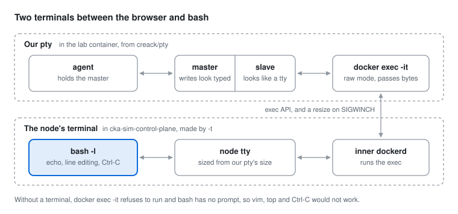
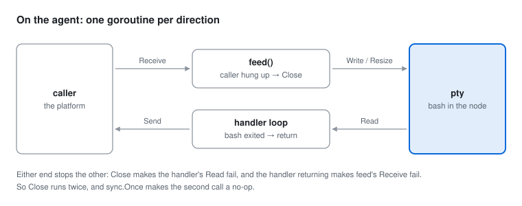

# The terminal: from the browser to bash on a node

The page's terminal is not an emulation. Every keystroke travels to a real bash on the lab's base host
([LAB.md](LAB.md#3-the-base-host-and-ssh)), and every character you see is that bash's echo coming back. This
file follows the path: the contract between the platform and the agent, then the pty that makes `docker exec`
interactive.

**Contents:** [1. Platform ⇄ agent](#1-platform--agent-connect-over-http2) ·
[2. The pty and `docker exec`](#2-the-terminal-a-pty-and-docker-exec) · [3. Try it](#3-try-it-yourself)

## 1. Platform ⇄ agent: Connect over HTTP/2

The contract is `apps/go-shared/contract/lab/v1/lab.proto`. Each app knows only the contract, never the other
app's code, and `make proto` regenerates it.

| Call | Kind | Transport |
| --- | --- | --- |
| `GetCluster`, `CreateCluster`, `DeleteCluster` | unary | Plain HTTP POSTs. They work over HTTP/1.1, even as JSON |
| `RunScript` | unary | The same; bash as root on one of the nodes |
| `OpenShell` | bidi stream | One call stays open as long as the terminal. Needs HTTP/2 |

A unary call from the shell:

```sh
curl -H "Authorization: Bearer $T" -H 'Content-Type: application/json' -d '{}' \
  http://127.0.0.1:7171/lab.v1.LabService/GetCluster
```

### Why the stream needs HTTP/2

HTTP/1.1 is request, then response: a client can't keep sending a body while it reads the answer. That's why
WebSocket exists. HTTP/2 is different: each request is a stream of frames inside one TCP connection, and both
bodies can stay open at the same time.



The last message carries the status, which is how FAILED_PRECONDITION reaches the caller. Connect reports a clean
end as an error that matches `errors.Is(err, io.EOF)`.

### h2c: HTTP/2 without TLS

Both sides have to opt in:

| Side | How |
| --- | --- |
| Agent | `protocols.SetUnencryptedHTTP2(true)` in `cmd/agent/main.go` |
| Platform | `http.Transport{Protocols: …SetUnencryptedHTTP2(true)}` |

> [!WARNING]
> A streaming client must not set `http.Client.Timeout`, because it would cut every shell off after that long.

**The browser hop stays WebSocket**, because browser JavaScript can't stream a request body over HTTP/2. The
platform translates:

| WebSocket | `OpenShell` |
| --- | --- |
| binary frame from the browser | `keys` |
| binary frame to the browser | `output` |
| text frame `{"type":"resize",cols,rows}` | `size` |

## 2. The terminal: a pty and `docker exec`

### What a pty is

A pseudo-terminal is a pair of file descriptors from the kernel:

- **slave:** looks like a real terminal. A program gets it as stdin, stdout and stderr and believes it is
  interactive.
- **master:** what our code holds. Bytes written there arrive as if typed, and whatever the program prints comes
  out there.

`docker exec -it` refuses to run without a terminal ("the input device is not a TTY"), and bash without one has
no prompt or line editing. So the agent starts the CLI under a pty with `github.com/creack/pty`
(`apps/lab/internal/infra/adapters/dockerexec/dockerexec.go`):

```sh
docker exec -it -e CKA_SIM_TERMINAL=<tag> -u candidate -w /home/candidate <cluster>-base bash -l
```



| Terminal | Who makes it | What it does |
| --- | --- | --- |
| Our pty | the agent, with creack/pty | The docker CLI puts it in raw mode, so it passes bytes straight through |
| Base's terminal | dockerd, because of `-t` | bash is attached to it, and bash does the echo and line editing |

After `ssh <node>`, there is a third: ssh asks sshd on the node for one, relays bytes to it over the kind
network, and forwards window size changes, so `vim` on a node redraws just like on base.

### One keystroke, end to end


```
key → xterm.js → WebSocket → platform → OpenShell {keys} → agent → pty master → pty slave
    → docker CLI → dockerd → base's terminal → bash on base   (→ ssh → sshd → bash on the node)
bash echoes "l" → the same way back → {output} → WebSocket → xterm.js draws "l"
```

> [!TIP]
> The browser never draws what you type. Every character you see, even a space, is bash's echo coming back.
> That's why passwords stay invisible, and why a slow network makes typing lag.

### Resize

Programs ask *their* terminal how big it is, so the browser panel's size is copied all the way down:

1. The fit add-on measures cols × rows and the page sends a resize message.
2. The agent gets `{size}` and calls `pty.Setsize`.
3. The kernel sends SIGWINCH to the docker CLI, which asks dockerd to resize base's terminal.
4. The kernel sends SIGWINCH to whatever runs there. bash, vim and top redraw; an ssh client passes the new size on
   to the node.

**The shell starts only at the first size** (`pty.StartWithSize`). A resize sent while the shell is still
starting can get lost, and the first prompt would be laid out for the wrong width. That's why the contract says
the first message is the size.

### Ending a shell

Killing the `docker exec` client does **not** kill what it started: bash keeps running on base. So every shell
gets a random tag in its environment. `Close` kills the CLI, then runs a script on base that finds every process
whose `/proc/<pid>/environ` holds that tag and sends it HUP, then KILL. An `ssh` the shell started carries the tag
too, and when it dies, sshd ends the session on the node. The idea comes from the first version's `dockershell.go` (`archive/v2`).

On the agent (`apps/lab/internal/api/shell.go`), each direction has its own goroutine, because Connect allows one
`Send` and one `Receive` at a time:



## 3. Try it yourself

**The terminal without the page**, once a lab is Ready:

```sh
cka-sim shell          # installed: candidate on base, like the page
ssh cka-sim-worker     # then kubectl works there
```
