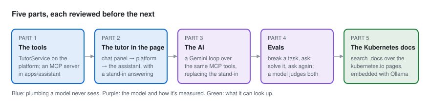
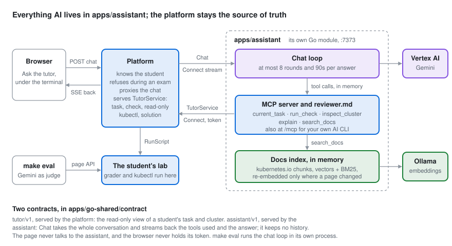

# The assistant, in five parts

The goal: an AI tutor that knows the task you're on, can look at your cluster and run the grader, and helps you
learn instead of doing the task for you. It sits in the task page as a chat, beside the terminal.

The tools come first: they're what any AI needs to be useful here (our own chat agent, an AI CLI, an eval
harness), and you can try them from your own Claude Code before the page has a tutor.

Each part is one feature, reviewed and committed before the next, as in [BUILD-IN-STEPS.md](BUILD-IN-STEPS.md):
**Scope**, **Review** (what to try before accepting it) and **Learn** (the idea to understand first).

## The shape

- **Everything AI lives in `apps/assistant`:**
  - the MCP server and its instructions (`reviewer.md`);
  - the chat and, from Part 3, the model loop and its credentials;
  - the evals;
  - the docs index and its search.

  It's its own Go module with the usual domain / use cases / adapters / api / cmd / e2e layout, and it imports
  nothing from the other apps.
- **The platform is the source of truth and the proxy.** It answers the tools through `TutorService`, and passes
  the page's chat to the assistant for the student it has identified, the way `/ws/terminal` passes the shell to
  the lab agent. The page never talks to the assistant directly.
- **Two contracts**, each a `.proto` in `apps/go-shared/contract/`, served and called with Connect:
  - `tutor/v1/tutor.proto` (Part 1), served by the platform: the read-only view of a student's task and cluster;
  - `assistant/v1/assistant.proto` (Part 2), served by the assistant: `Chat`, which takes the whole conversation
    and streams back the tools used and the answer. The assistant keeps no conversation.
- **Tokens:** `CKA_SIM_ASSISTANT_TOKEN` is shared by the platform and the assistant (`rpcauth`, as with the
  agent): the assistant sends it to `TutorService`, the platform sends it to `Chat`. The student is named in each
  call.

## Part 1 · The tools

Built in two halves, each reviewed on its own.

### 1a · TutorService on the platform

- **Scope:**
  - `tutor.proto` with `TutorService`. Every call names a student; the platform refuses one it doesn't know
    (`NOT_FOUND`) and any call while that student's exam runs (`FAILED_PRECONDITION`):
    - `GetCurrentTask`: the task the student set up last and hasn't left (tidied). The platform remembers it per
      student, in memory;
    - `CheckTask`: the real grader; its PASS/FAIL lines are the only judge of a pass;
    - `InspectCluster`: one kubectl command, from an allowlist of read verbs (`get`, `describe`, `logs`,
      `events`, `top`, `explain`, `api-resources`, `auth can-i`) and flags. It runs as root on the control
      plane through the existing `RunScript`, every argument quoted, under `timeout 15`, its output cut to
      16 KiB. Anything else is `INVALID_ARGUMENT`;
    - `GetSolution`: the solution, for when the student asks for it.
  - Mounted at `/tutor.v1.TutorService/` beside the page's API, only when `CKA_SIM_ASSISTANT_TOKEN` is set.
  - Tests: unit tests for the allowlist (`delete`, `exec`, `--kubeconfig`, `-o go-template`, `;` and `$(…)`
    refused) and the current task; e2e over Connect against the fake agent.
- **Review:**
  - `InspectCluster` with `get pods -A` runs `timeout 15 kubectl 'get' 'pods' '-A'` on the control plane.
  - `delete pod x`, `get pods; rm -rf /` and `get pods --kubeconfig=/x` are refused before reaching the lab.
  - Set up a task in the page, and `GetCurrentTask` names it; leave the task, and it has none.
  - During an exam, every call is refused.
- **Learn:** an allowlist beats a denylist when a model builds the command; the grader, not the model, decides.

### 1b · The MCP server in apps/assistant

- **Scope:**
  - `apps/assistant` as its own module: `cmd/assistant` serving MCP (`github.com/modelcontextprotocol/go-sdk`,
    Streamable HTTP) on `127.0.0.1`, calling `TutorService` with the token.
  - Tools `current_task`, `run_check`, `inspect_cluster`, `explain` (the solution, only when asked), and
    `reviewer.md` (who it is: help you learn, don't do the task, stay on the CKA and this lab) as the server's
    instructions.
  - The student is fixed by config (`local` by default); the page's chat names its own (Part 2).
  - `make assistant` runs it (`CKA_SIM_ASSISTANT_ADDR`, `CKA_SIM_PLATFORM_URL`, `CKA_SIM_ASSISTANT_TOKEN` from
    `.env`); `claude mcp add --transport http cka-sim http://127.0.0.1:7373/mcp` connects it.
- **Review:** from your own Claude Code, on a task you set up:
  - "what am I working on?" names the task;
  - "review my attempt" runs the grader and explains the failing check without giving the answer;
  - "delete the pod" gets nowhere.
- **Learn:** MCP as the one seam between any AI and your system.

## Part 2 · The tutor in the page (a stand-in answers)

Build the whole path first with a harmless answer at the end of it, so the parts that can go wrong (streaming,
errors, the exam rule, the page) are reviewed before any model is involved.

- **Scope:**
  - `assistant.proto` with `AssistantService.Chat`: student, the task open in the page, the conversation; a
    stream of `tool` and `text` events back.
  - `apps/assistant`: a `chat` domain; `Reply` is a stand-in that reads the current task (a real tool event) and
    echoes the question. Served beside `/mcp` on the same port.
  - The platform: `POST /api/assistant/chat` (at most 40 messages, each at most 8 KiB, alternating and ending
    with the student), answered as server-sent events `tool`, `text`, then `done` or `error`. Refused during the
    student's exam (409); off without `CKA_SIM_ASSISTANT_URL` (503 `assistant_off`).
  - The page: **Ask the tutor**, an accordion under the terminal (drag its top edge to resize), with the tools it used, its answer as
    Markdown built node by node (HTML stays text, only http(s) links are links), and errors that keep the
    question to ask again.
- **Review:** with `make dev` and `make assistant`, ask on a task page; set up the task and ask again, and the
  stand-in names it; stop the assistant and the panel says it doesn't answer.
- **Learn:** streaming an answer through two hops, and why the browser never holds the assistant's token.

## Part 3 · The AI

- **Scope:** `Reply` becomes a loop on the chat's `Model` interface (Gemini on Vertex, `gemini-3.5-flash`,
  `CKA_SIM_VERTEX_PROJECT`) over our own MCP server, reached in memory for the chat's student, so the page and
  an AI CLI share the tools and `reviewer.md`. At most 8 rounds and 90s per answer. Without a project, the
  assistant says it has no AI.
- **Review:** "why does my check fail?" runs the check and points at the failing part without the answer; "show
  me the solution" uses `explain`; text in the cluster that reads like instructions doesn't steer it.
- **Learn:** a tool loop, and keeping the model behind an interface so another provider is one adapter.

## Part 4 · Evals

- **Scope:** for each task, set it up through the page's API, ask the tutor "my check fails, why?", and score
  whether it names what the failing checks test. Then run the solution and ask again: it should find nothing
  wrong. A second score: did a hint give the answer away?
- **Review:** a report per task and a total; a run on a handful of tasks is cheap enough to repeat.
- **Learn:** measuring an agent against ground truth you already have.
- **Built:** `apps/assistant/cmd/eval`, the `evals` domain and the `pageapi` adapter.
  - **Flow:** per task, through the page's API as the local student: `start` (heal and setup), `check`, `solution`
    (the explain), then the tutor is asked, then `POST /api/tasks/{id}/solve` (new: runs `solution.sh`, refused
    during an exam, also used by the selftest), `check`, the tutor again, and `tidy` whatever happened. The tutor
    is the real `Reply` loop run in the eval's own process over the same in-memory MCP server and `reviewer.md`,
    so a prompt or model change is measured without restarting `make assistant`.
  - **Scoring:** an LLM judge, the same Gemini through `Model`, with two strict rubrics that answer JSON only.
    Broken: which of the numbered failing checks (`tasks.ReadGrade`'s FAIL lines) the answer names, and whether
    it gave the answer away (a full manifest or pasteable commands, judged against the explain), with the quote
    that did. Solved: whether it says nothing is wrong. A task passes when it names every failing check, gives
    nothing away and finds nothing wrong after the solution. Keywords can't tell "check the Service type" from a
    restated task, and the checks' descriptions are short enough for a judge to match reliably. The report keeps
    the answers, the tools used and the judge's reasons, so any verdict can be checked by eye.
  - **Run:** with `make dev` (or `make serve`) on a ready lab, `CKA_SIM_ASSISTANT_TOKEN` and
    `CKA_SIM_VERTEX_PROJECT` set, and `gcloud auth application-default login`: `make eval` runs five tasks, one
    per domain; `make eval TASK=nw-nodeport,tr-cni` picks. It prints a line per task and the total, and writes
    `apps/assistant/bin/eval-report.md`. About four model answers per task. Not part of `make test`.

## Part 5 · The Kubernetes docs (built before Part 4)

- **Scope:**
  - `make docs-index` makes a sparse clone of `kubernetes/website` (`content/en/docs` and `examples`, `main`,
    which holds v1.37 until `release-1.37` is cut) in `~/.cache/cka-sim/website`, and runs `cmd/docs`. That
    command cuts every page at its `#`, `##` and `###` headings (the `website` adapter, ported from
    `archive/v2`: Hugo shortcodes resolved, examples inlined, about 2,000 characters a chunk, each with its
    `Page › Section` trail and anchor link). It embeds the chunks with Ollama (`nomic-embed-text`, with its
    `search_document:` / `search_query:` prefixes) into one gzipped gob file,
    `apps/assistant/data/docs-index.gob.gz`, committed so the tutor has its docs without a local Ollama run.
  - **Each page has a hash** of its chunks (and of the chunking's version), so a re-run embeds only the pages
    that changed, and drops the pages that are gone. The index is saved every 512 chunks, so a stopped run
    carries on. Another embedding model embeds every page again.
  - `make assistant` loads the index into memory. `search_docs` embeds the question and searches hybrid: the 40
    nearest chunks by cosine and the 40 best BM25 matches on any of the question's words, merged by reciprocal
    rank fusion (k = 60). It answers the top 5 with their links. There's no `search_docs` without an index, and
    an index from another model stops the assistant at start. `reviewer.md` says to look things up and link them.
- **Review:** `make docs-index` twice (the second embeds nothing); ask the tutor "what is a
  PodDisruptionBudget?" and expect a kubernetes.io link.
- **Learn:** chunking real docs, embeddings, and why keyword search still matters next to vectors.
- **Left out:** a retrieval eval (recall@5 per mode, with Part 4), the docs in compose or on GKE (no Ollama
  there yet; the `Embedder` interface takes Vertex in one adapter), Postgres and pgvector.

## Later

Ideas, each its own step:
- **An AI CLI in a terminal tab** (gemini-cli or Claude Code in a pty, as `/ws/terminal` does for the shell),
  locked down by managed settings: no shell, edit, write or web tools, only our MCP server.
- **Guards on tool output:** flag cluster text that reads like instructions to the AI.
- **Learner notes** across tasks.
